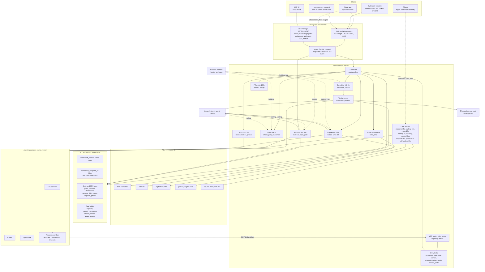
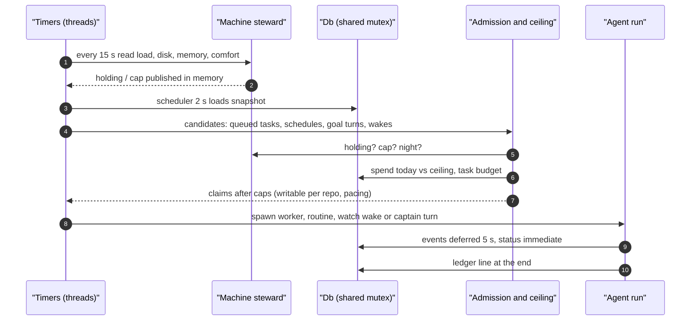
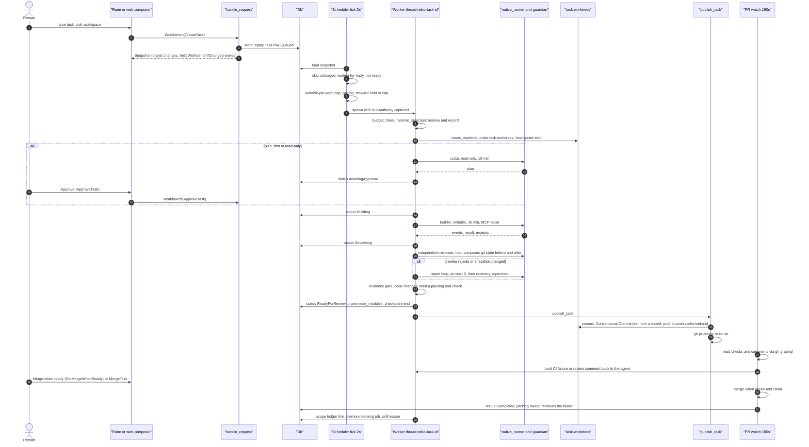
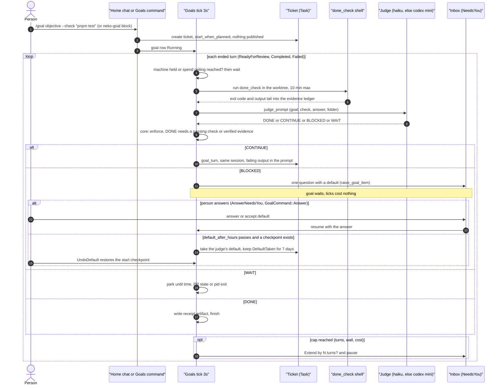
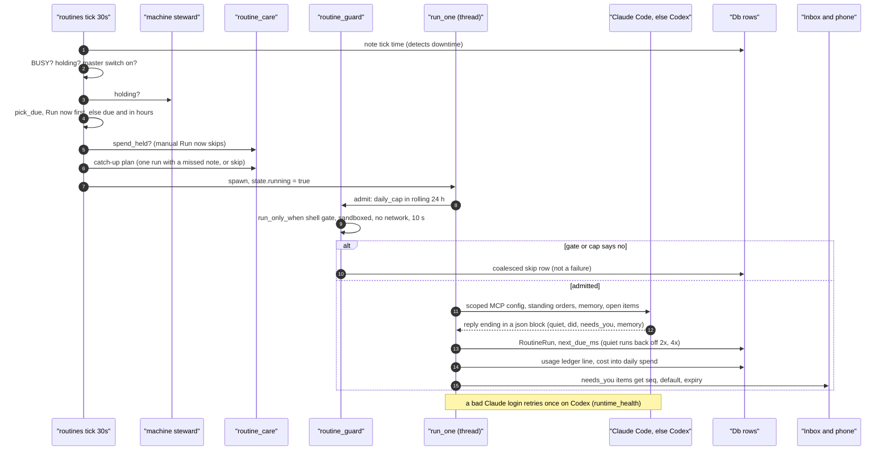
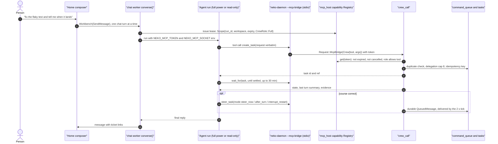
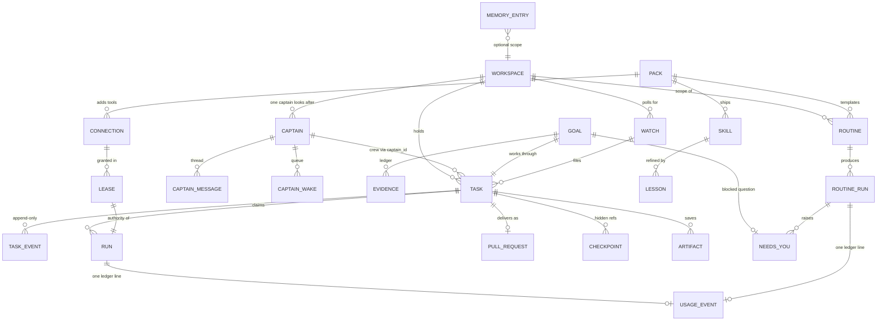

# Neko system map (2026-11-20)

A map of what is on disk today, read from the code, not from the plans. Every claim names a path (line numbers are as of this
date and drift; the symbol names are the stable part). Where this disagrees with `docs/architecture.md`, `CLAUDE.md` or a
knowledge note, the code is the truth and section 9 lists the disagreement.

Status of the working tree: the captain thread, wake queue and turns (batch B2) are **in progress**: they exist as uncommitted
changes and untracked files (`crates/neko-core/src/captain_thread.rs`, `captain_prompt.rs`,
`crates/neko-daemon/src/workbench/captains.rs`, `captains_tests.rs`, two prompt goldens). B1 (records, files, requests) is
committed (`d3e640bb`). B3 (`ask_person`, `Needs`, per-captain limit) is not started. Everything B2 touches is marked
**[B2, in progress]** below.

---

## 1. Summary

Neko is a single resident Rust daemon (`neko-daemon`) that owns one SQLite file, one Unix socket and one loopback HTTP bridge,
and that runs a dozen independent timer-driven threads against a shared `Arc<Mutex<Db>>`. The person (or another client) sends
typed `Request`s; the daemon turns work into **tasks** (the Rust type `Task`; "ticket" in code comments, "session" in the newer
UI and captain docs), checks each against an admission policy (machine steward, per-repository write cap, budgets, authority),
and spawns a coding agent (Claude Code, Codex or OpenCode, each under its own login) in an isolated git worktree under a
process guardian. The daemon, never the model, commits, pushes, opens and merges pull requests. On top of that execution core
sit things that keep working without being asked: **goals** (a task re-run turn by turn until a shell check or verified evidence
says DONE), **routines** (cadenced agent runs that act and then report a "needs you" list), **watches** (MCP sources polled
into tasks), **captains** (named per-workspace agents with their own thread, files and wake queue, directing a crew of
sessions through MCP crew tools), a **self-improvement** loop, a **skill curator**, a **phone push** channel and a **self-updater**.
The UIs are thin: the web app (`web/`), the Rune native app (`apps/neko-rune/`, its own Cargo workspace, becoming the default),
a Swift shell (`native/NekoKit`, legacy but still the installed host today) and a retired GPUI client (`crates/neko`).
Safety rests on host-held authority (leases, run authority, allow-lists), sandboxing where the runtime allows it, process
guards, and gates that need the person (approval, pack digests, destructive confirms).

---

## 2. Component map

### Component table

| Component | Crate / module paths | Responsibility | Key types |
| --- | --- | --- | --- |
| Wire protocol | `crates/neko-protocol/src/lib.rs` (`Frame`, `Request`, `Response`, `Event`), `workbench.rs` (`Command`, `Snapshot`) | Typed requests, frames (u32 LE length + JSON, 16 MiB cap), paths (`socket_path`, `database_path`, `support_dir`, `NEKO_DATA_DIR`) | `Request`, `Command`, `Snapshot`, `Task`, `TaskStatus` |
| Daemon entry | `crates/neko-daemon/src/main.rs:125` | Singleton bind, open DB, spawn threads, accept loop (one thread per connection). Also the MCP bridge, process guardian, `--machine-check`, `--request` modes of the same binary | `AppState` (`server.rs:44`) |
| Socket + HTTP transports | `server.rs` (`handle_connection`, `handle_request`, `spawn_web_bridge:1475`), `web.rs` (`route:476`, `Backend` trait, `ARTIFACT_CSP`) | Same handler for both; HTTP adds Host/Origin/Sec-Fetch/token gates, artifact CSP, attachments, plugins, `/api/chat/*`, `/api/events` | `Backend`, `WebBackend`, `Event` broadcast lists |
| Store | `crates/neko-core/src/db.rs`, `workbench.rs` (`load`/`save`), `captain_thread.rs`, `usage_ledger.rs` | One `Db` behind `Arc<Mutex<Db>>`; WAL; deferred vs immediate writes; content-stamped load cache | `Db`, `ContentStamp`, `DEFERRED_WRITE_DELAY` |
| Controller / scheduler | `crates/neko-daemon/src/workbench.rs` (`start:623`, `tick:732`, `tick_with:744`, `execute`, `execute_with_worktree_in`) | The 2 s supervisor: schedules, queue delivery, admission, one worker thread per claimed task | `Controller`, `TaskClaim`, `Active` |
| Admission | `workbench/admission.rs`, `neko-core/src/machine.rs` | Writable-per-repository cap (default 2), load pacing (one per 10 s), steward hold/cap, user caps | `cap_writable_per_repository`, `admit`, `MachineHealth` |
| Agent runners | `neko-core/src/native_runner.rs`, `native_runner/cli_workers.rs` (Claude, OpenCode), Codex adapter in `native_runner.rs` | Spawn, stream events, sessions/resume, sandbox flags, worktrees, publish helpers | `RunSpec`, `Session`, `AgentRuntime`, `GuardedChild` |
| Task pipeline | `workbench.rs` (scout, builder, reviewer), `workbench/review_repair.rs`, `splits.rs`, `replies.rs`, `native_runner/publish.rs`, `workbench/publish.rs` | Plan, build, independent review, repair loop (3), evidence gate, deliver | `TaskStatus`, `SupervisorDecision`, `TaskSplit` |
| PR watch | `workbench/pull_requests.rs`, `neko-core/src/pull_requests.rs` | Follow open PRs every 180 s, hand CI/comments back, merge on request | `PullRequest`, `Observed`, `Next` |
| Home chat | `neko-core/src/neko_chat.rs`, daemon `workbench.rs` (`send_chat:377`, `converse:1692`) | One conversation (`neko_chat_v2`), one turn at a time, may open tickets, tool cards with approval, full-power mode | `ChatMessage`, `ChatAction` |
| MCP host, bridge, leases | `neko-daemon/src/mcp_host.rs`, `neko-core/src/mcp_host/{capability,bridge,responsibility,store,oauth,credentials}.rs` | Hosts user MCP servers (rmcp), per-run capability tokens, stdio bridge exposing `neko_list_tools`, `neko_call_tool` and crew tools | `Scope`, `Registry`, `BridgeAction`, `RunAuthority` |
| Crew tools | `neko-daemon/src/workbench/crew.rs`, `neko-protocol/src/crew.rs`, `neko-core/src/{crew,command_queue}.rs` | The 12 orchestration tools gated by `CrewRole`; durable steer/queue delivery | `CrewRole`, `QueuedMessage`, `DeliveryMode` |
| Goals + judge | `neko-core/src/goals.rs`, `neko-protocol/src/goals.rs`, `workbench/goals.rs` | Re-run a ticket per turn, run `done_check`, cheap judge, evidence-gated DONE, Blocked question with default, WAIT, quota hold, receipts | `Goal`, `GoalStatus`, `Verdict`, `Evidence` |
| Routines | `neko-core/src/routines.rs`, `neko-daemon/src/{routines,routine_guard,routine_care}.rs`, `neko-protocol/src/routines.rs` | Cadenced scoped agent runs; reply JSON becomes `RoutineRun`; guard rails; catch-up | `Routine`, `Cadence`, `RoutinePolicy`, `RoutineRun`, `NeedsYou` |
| Watches | `workbench/responsibilities.rs`, `neko-core/src/mcp_host/responsibility.rs`, `triage.rs` | MCP-source polling into tasks, probe replay (180 s) vs full wake (10 min), dedupe, triage | `Responsibility`, `ToolReceipt`, `RunAuthority` |
| Schedules | `workbench/scheduled_plans.rs`, `neko-core/src/{scheduled_plans,schedule_time}.rs` | RRULE-like schedule enqueues a read-only plan task | `Schedule`, `ScheduleCommand` |
| Captains **[B2, in progress]** | `neko-core/src/{captains,captain_files,captain_thread,captain_prompt}.rs`, `neko-daemon/src/captains.rs`, `workbench/captains.rs`, `neko-protocol/src/captains.rs` | Named per-workspace agent: records, four files, own thread, wake queue, one turn at a time | `Captain`, `CaptainWake`, `WakeReason`, `CrewRole::Captain` |
| Inbox / needs-you | `neko-core/src/inbox.rs`, `neko-daemon/src/{routines,inbox_reply}.rs`, `neko-protocol/src/routines.rs:177` | Open items with default, expiry, auto-close; answered by `AnswerNeedsYou` | `NeedsYou`, `OpenItem` |
| Memory, rules, skills, curator | `neko-core/src/{neko_memory,memory_learning,decision_context,rulebook,agent_profiles}.rs`, `skills.rs`, `skills/{lessons,curator,revise}.rs`, `workbench/{memory_learning,skill_curator}.rs` | What Neko learned (bounded, never authority), rulebook, skill lessons and daily curator | `MemoryEntry`, `SkillProposal`, `Curation` |
| Packs + Luau | `neko-core/src/packs.rs`, `neko-daemon/src/packs.rs`, `neko-protocol/src/packs.rs`, `apps/neko-rune/src/luau/`, `packs/` | One installable unit (tools, skills, web plugin, routines, Luau UI), digest-bound approval | `PackCommand`, `PackStatus`, `PackUiFile` |
| Usage ledger + budgets | `neko-core/src/{usage_ledger,spend}.rs`, `neko-protocol/src/ledger.rs` | One append-only line per run (365 days), daily ceiling, per-ticket budget | `usage_events`, `Today`, `Source` |
| Machine steward | `neko-core/src/machine.rs`, thread `neko-machine` in `workbench.rs:680` | Reads load/memory/disk/thermal every 15 s, publishes `holding` and `cap`, renices builds, publishes agent rules | `MachineHealth`, `apply_policy` |
| Checkpoints / undo | `neko-core/src/checkpoints.rs`, `workbench/{checkpoints,run_checkpoints}.rs` | Hidden-ref snapshots at run start and end, diffs, undo/redo with refusals | `Point`, `CheckpointCommand` |
| Phone + digest | `neko-core/src/{phone,digest}.rs`, `neko-daemon/src/{phone,morning_digest}.rs` | Push needs-you to ntfy and Reminders (EventKit lives in the Swift/Rune app), quiet hours, 6/hour cap | `PhoneSettings`, `Push` |
| Self-improvement | `neko-core/src/improve.rs` + `improve/`, `neko-daemon/src/improve.rs` | Repeated trouble becomes one Inbox suggestion, applied on click, verified 7 days | `Improvement`, `ImproveKind` |
| Self-update | `neko-core/src/self_update.rs`, `neko-daemon/src/self_update.rs` | Clean clone of published repo, classify changed paths, swap web build or reinstall when idle | `Classification`, `Decision`, `UpdatePlan` |
| Search providers (launcher heritage) | `neko-core/src/provider.rs:39` + 24 `impl Provider` | The extension seam for result types; still compiled into the daemon | `Provider`, `AppState::providers` |
| Rune app | `apps/neko-rune/src/{link,view,luau,browser,viewers}`, `tests/allow_list.rs` | Native client; socket for snapshot and commands, HTTP for files; request allow-list; CDP watch-only browser tab | `ReadRequest`, `Call`, `CDP_METHODS` |
| Web UI | `web/src/{api.ts,useStore.ts,registry.ts,canvas,chat,plugins.tsx}` | One window of tabs; held `WorkbenchIfChanged` plus SSE | store, page registry, viewer registry |

---

## 3. The heartbeat

There is no single heartbeat. Each loop below is its own thread with its own clock. Only `Snapshot::heartbeat_ms` is called a
heartbeat in code, and it is memory-only, refreshed by the 2 s tick (`workbench.rs:732`), never persisted.

| Loop (thread) | Interval | Reads | Can start | Limited by |
| --- | --- | --- | --- | --- |
| Scheduler (`Controller::tick`, `workbench.rs:706-716`) | 2 s | whole snapshot, schedules, queued messages | schedule-made plan tasks (`schedule_tick`), queued-message delivery (`deliver_queued`), **task workers** | steward `holding` (clears all claims) and `cap` (minus `active.len()`); writable-per-repository cap (default 2); load pacing (`admission::admit`, one per 10 s above load); optional `max_running_tickets`; per-task budget; `RunAuthority::valid`; waits for replies and untriaged tasks (`workbench.rs:744-830`) |
| Watch tick (`responsibility_tick`, `workbench.rs:718`) | 2 s poll; due time per watch: next probe 180 s, full wake max age 3 h, failure backoff up to 1 h (`responsibility.rs:247-258`) | enabled `Responsibility` rows | a read-only agent wake (600 s timeout) that may file tasks | one wake at a time (`waking` try_lock); probe replay of read-declared tools first. **No steward or spend-ceiling check was found in `responsibilities.rs`** (grep) |
| Goals (`neko-goals`, `goals.rs:17`) | 3 s | goal rows, task statuses | next turn of a goal's ticket (`goal_turn`), done_check shell (10 min), judge (90 s), receipt writes | `machine_held` and `routine_care::spend_held` (`goals.rs:596-600`); turn/wall/cost caps; wall clock advances only while running, steps at most 60 s |
| Routines (`routines::spawn`, `routines.rs:355`) | 30 s | routine definitions, state rows | one routine run (15 min, 30 min for long kinds) | `BUSY` (one at a time); steward `holding`; master switch (`routines_on`); cadence window (`in_window_local`); daily spend ceiling (`routine_care::spend_held`, manual Run now bypasses); `RoutinePolicy.daily_cap`, `run_only_when` (`routine_guard.rs`); catch-up rule after downtime |
| Captains **[B2, in progress]** (`neko-captains`, `workbench/captains.rs:19`) | 3 s | captains, sessions, wake rows | one agent turn per captain (20 min cap), read-only in the captain's workspace | one turn per captain; steward `holding` and `cap` (counts tickets + Home chat + captain turns); daily spend ceiling; unattended turns: oldest wake at least 20 s old, at least 60 s apart, 40 turns per local day (`captain_thread.rs:15-21`); a person's message skips the debounce and caps |
| PR watch (`neko-pull-requests`, `pull_requests.rs:16`) | 180 s (wakeable) | tasks with an open PR | hand-back of CI failure/comment to the task agent, branch update, merge | merge only if `merge_when_ready` (or `merge_without_review`) and checks pass; `gh` timeouts 30/90 s |
| Machine steward (`neko-machine`, `workbench.rs:680`) | 15 s (kernel_task sample every 4th) | sysctl, df, vm_stat, ps, `~/.agents/bin/machine-ok` | nothing; publishes `holding`, `cap`, renices builds at night over load 12, writes `agent-rules.md` | thresholds in `machine::apply_policy` (disk under 15 GB, memory critical, load 20+, night load over 12, comfort WAIT); cap 1 at 01:00-06:00 or memory warning |
| Parking sweep (`neko-parking`, `parking.rs:18`) | 60 s | tasks with no worker | parks idle worktrees on their branch | 2 min quiet, 5 per pass, skips live workers and in-flight publishes |
| Triage (`neko-triage`, `triage.rs:8`) | 10 s | `untriaged` tasks filed by watches | one tool-free model call per task | skips at load 20+; releases after `MAX_WAIT_MS` or `MAX_ATTEMPTS` |
| Naming (`neko-naming`, `display_names.rs:12`) | 5 s | tasks and watches without a name | one cheap model call | backoff on failure |
| Memory learning (`start_learning`, `memory_learning.rs:6`) | 2 s base, backoff to 30 s | learning jobs for finished tickets | one extraction run | one resident worker; recovers interrupted jobs |
| Skill curator (`neko-skill-curator`, `skill_curator.rs:11`) | wake 10 min, pass once a day | skill lessons | up to `PER_PASS` cheap-model calls | only when Mac idle: steward not holding, no comfort WAIT, no goal active, no worker (`idle_for_curator`) |
| Self-improvement (`neko-improve`, `improve.rs:18`) | 60 s; gather every 6 h or after an event (at most every 10 min); verify always | tasks, signals | one cheap-model call, an Inbox suggestion | `PER_DAY` 3 proposals, same idle check as the curator, off switch |
| Phone + digest (`phone::spawn`, `phone.rs:17`) | 30 s | new needs-you items, digest due | ntfy push, queued Reminders, morning digest compose | quiet hours, at-Mac idle 180 s (`AT_MAC_SECS`), 6 pushes per hour, 24 h hold cap (`phone.rs` core consts) |
| Self-update (`neko-self-update`, `self_update.rs:34`) | 10 s tick; `ls-remote` at most every 10 min | published `main` | web swap, or detached installer | native reinstall only when nothing runs or publishes and `machine-ok` agrees |
| MCP discovery (`workbench.rs:695`) | 2 s | connections | tool discovery and retry | panics caught per tick |
| Always-on utilities (`main.rs`) | clipboard loop, app watcher, icon cache, native attention poll | OS state | nothing agentic | legacy Paseo/Codex pollers only with `NEKO_LEGACY_AGENTS` |

What is not a loop: Home chat, a person's Run now, the HTTP/socket handlers. They start work on demand and bypass the timers.
Things that count against the ceilings are not the same set (section 9, S3 and S4).

---

## 4. Life of a request

### 4a. A task typed in the composer, through to a merged PR

Entry points to the same `Task`: the session composer sends `Command::CreateTask`/`CreateTaskInFolder`; the Home composer sends
`Command::SendMessage` and the reply can propose up to three tickets (`workbench.rs:2120-2200`, with a duplicate check first,
`neko-core/src/duplicates.rs`); a watch files one; a crew tool or captain creates one (`crew.rs:369`); a goal makes its own.

Facts behind it: planning is skipped by default (`work_directly = !plan_first && !read_only && !pending_split`,
`workbench.rs:1000`); a reviewer's verdict needs a passing structured result plus host-observed coverage
(`native_runner/review_state.rs`); only the daemon publishes (`workbench/publish.rs:39`); subtasks ship in the parent's PR; repos
in `land_on_main` fast-forward local `main` instead of opening a PR (`publish::land`).

### 4b. A goal runs until DONE, asks, or takes a default

Other exits: a usage-limit error holds the goal until the reset time (`core::hold_until_ms`); a Claude stall is resumed once and
not counted; a judge error is CONTINUE (fail open) bounded by the turn cap (`docs/knowledge/goals-that-keep-working.md`).

### 4c. A routine fires on its cadence

### 4d. The Home chat directs the crew through MCP crew tools

The role, not the model, decides which tools exist: `CrewRole::allows` (`neko-protocol/src/crew.rs`). Full gets all except
`captain_write`; ReadOnly gets list and status; a ticket's own run gets list, status, wait, checkpoint_diff, save_artifact
(and create when allowed); a captain gets list, status, create, steer, checkpoint_diff, captain_write, and wait/cancel only in a
person turn **[B2, in progress]**.

---

## 5. State and storage

One SQLite file (`<data>/neko.db`, WAL, `synchronous=NORMAL`, 8 MB journal limit; `neko_protocol::database_path`). One `Db`
object behind `Arc<Mutex<Db>>` is shared by every thread (`server.rs:46`); model calls run outside the lock by convention.

### Row families

| Family | Where | Shape | Write mode |
| --- | --- | --- | --- |
| Tasks | tables `workbench_tasks`, `workbench_task_events` (`db.rs:247-256`) | one row per task, append-only events, only new events inserted | immediate for decisions; agent tool events and PR status are **deferred** (`save_deferred`, at most every 5 s, flushed by the scheduler tick or `Db` drop) |
| Workbench remainder | settings `workbench_snapshot_v1` (about 110 KB), `workbench_task_order_v1`, `workbench_mcp_connections_v1`, `workbench_mcp_sources_v1`, `workbench_mcp_source_v1:<id>` | JSON | immediate |
| Timer rows split out of the snapshot | `workbench_mcp_receipts_v1` (deferred), `workbench_pull_request_status_v1` (deferred), `workbench_watch_schedule_v1` (immediate: due times are durable claims), `workbench_self_update_check_v1` | JSON | as noted |
| Goals | `neko_goal_v1:<id>`, `neko_goals_index_v1`, `neko_run_log_v1:<subject>`, `neko_goal_clock_v1` (deferred) (`goals.rs:19-22`) | JSON rows | immediate, clock deferred |
| Routines and Inbox | `routines_v1`, `routine_state_v1:<id>`, `routine_runs_v1:<id>` (last 50), `routine_seq_v1`, `routines_master_v1` | JSON rows; needs-you items live inside `RoutineRun.needs_you` | `set_setting_quiet`: wake no reader |
| Checkpoints | `neko_checkpoints_v1:<task>`, `neko_checkpoints_index_v1`; git refs `refs/neko/checkpoints/<task>/...` | JSON + hidden refs | quiet |
| Crew | `neko_cmdq_v1:<task>`, `neko_crew_origin_v1`, `neko_crew_cap_v1`, `neko_crew_idem_v1` | JSON | immediate |
| Memory, rules, skills | `neko_memory_v1`, `neko_decision_context_v1`, `neko_skills_v1`, `neko_skill_curator_v1`, `neko_chat_v2`, `neko_chat_checkpoint_v1:*` | JSON | immediate |
| Self-improvement, phone, digest | `improve_state_v1`, `improve_signals_v1`, `phone_settings_v1`, `phone_state_v1`, `neko_digest_v1`, `neko_spend_notice_v1` | JSON | quiet |
| Captains **[B2, in progress]** | tables `captains` (JSON body), `captain_messages` (append-only), `captain_wakes` (`db.rs:273-290`); settings `neko_captains_rev_v1`, `neko_captain_seen_v1:<id>` | tables + two rows | rev row via `set_setting` (wakes readers); wakes and seen rows quiet |
| Usage | table `usage_events` (`run_key` unique, `reported`/`estimated`, 365-day prune) | rows | never wakes readers |
| Misc | `settings`, `launches`, `clipboard_entries`, theme/appearance/hotkey keys | legacy launcher tables | immediate |

Change signalling is three separate mechanisms: a process-wide `DATA_REVISION` bumped by non-quiet settings writes
(`db.rs:50-60`) that wakes held `WorkbenchIfChanged` requests; the row-based `captains_rev` that rides in `Snapshot` **[B2]**;
and the broadcast `Event` enum (`IconsUpdated`, `ArtifactsChanged`, `ShowArtifact`, `OpenTab`, `UnseenTasksChanged`,
`WebUpdated`, ...) pushed over sockets and `/api/events`. `load` serves a cached snapshot while the content stamp is unchanged
(`db.rs:13-30`).

### Files (data dir `~/Library/Application Support/neko`, or `NEKO_DATA_DIR`)

| Path under `<data>` | Holds |
| --- | --- |
| `neko.sock`, `neko.db` (+ WAL), `web-token` (0600) | transports and store |
| `task-worktrees/<task>` | one git worktree per running task; parked ones removed, work kept on branch `codex/neko-<folder>` |
| `artifacts/<id>/v<n>.<kind>` | canvas artifacts (5 MB, confined), including goal receipts |
| `captains/<id>/{RULES,CREW,PLAN,DIGEST}.md` and `.prev` | captain files, 16 KB each, 0700 folder |
| `packs/`, `skills/`, `plugins/`, `plugin-data/`, `cleanup-archive/packs/`, `custom.css`, `themes/` | installed packs, skills, web plugins and their storage |
| `source/`, `web-live/`, `web-live.next`, `web-live.prev`, `web-builds/`, `self-update/`, `app-shell` | self-update clone, served web build, installer state |
| `attachments/`, `spill/`, `agent-rules.md` | composer files, oversized tool output, machine rules for outside agents |

---

## 6. Safety and authority

**Who may do what (host-held, not model-held).**
- *Run authority.* Tickets and watches capture a `RunAuthority` at claim time (`responsibilities.rs`, `for_task`/`new`/`valid`);
  `valid(&snapshot)` is re-checked before execution and at commits (`commit_authorized`). `for_task` drops unusable MCP
  connections so one broken connection no longer blocks tickets; watch wakes stay strict. A connection that breaks mid-run
  discards the run.
- *Leases.* An in-process `Registry` (`mcp_host/capability.rs`) hands out 32-byte random tokens (from `/dev/urandom`), never
  persisted or logged, at most 32 live, with expiry and cancel flags; the stdio bridge (`--mcp-bridge`) presents the token over
  the socket. Upstream credentials never reach workers; Neko-owned credentials are per-connection Keychain entries.
- *Roles.* `CrewRole` (Full, ReadOnly, Task, Captain) gates the 12 crew tools; mutating calls are idempotent and audited into
  task events (`crew.rs`). Captains see only their own crew (`crew.rs::visible`) and cannot rewrite `RULES.md`/`CREW.md` on a wake.
- *What only the host does.* Commit, push, open PR, merge, delete worktrees, undo. Models propose; `publish.rs`,
  `pull_requests.rs`, `checkpoints.rs` act. Only reviewed work leaves the machine.
- *Approvals that need the person.* Plan approval (when `plan_first`), explicit Start/Approve for local authority, chat tool
  calls that are not `readOnlyHint` (120 s expiry, exact-call approval, denied = never dispatched), pack install (digest of what
  was shown must match), pack "Changed on disk", merge on request only, skill proposals as diffs, self-improvement applied only
  on click. "Full power" (default per the owner) removes the per-call approval for Home chat and runs it writable.

**Sandboxing and what is not sandboxed.**
- Read-only Codex runs use a read-only permission profile with denials for private home folders (`native_runner.rs:1154-1190`);
  read-only Claude/OpenCode runs go through macOS `sandbox-exec` with writes only to CLI state and a private temp
  (`cli_workers.rs:422-430`); extraction runs get no tools (`dontAsk`).
- Writable runs have **no filesystem isolation** (Codex `--dangerously-bypass-approvals-and-sandbox`, Claude
  `bypassPermissions`); detection only: the host snapshots git HEAD, index, tracked and untracked content around a review and
  rejects source mutations (`review_state.rs`). Home-folder runs get a ripgrep privacy config and a prompt note.

**Process guards (`native_runner.rs`).** The daemon re-execs itself as a guardian (`run_guard_if_requested`, `spawn_guarded`)
that ends the child's process group when the daemon's socket end closes, so no `mdfind -live` or Codex app-server outlives a
restart. `execute_with_guard` records descendants every 250 ms (`Descendants`, libproc, pid + start time) and SIGKILLs survivors
and their groups when the run ends. Wall-clock timeouts: builders 30 min, planning and review 10 min, routines 15/30 min,
captain turns 20 min, goal check 10 min, judge 90 s; Codex ends after 10 silent minutes (`StallGuard`), Claude after 10 minutes
with no tool in flight.

**Allow-lists and gates on transports.**
- HTTP bridge: loopback bind only, exact `Host`, `Origin`, `Sec-Fetch-Site`, then a constant-time bearer/cookie token
  (`web.rs` header comment); artifacts under their own CSP and `<iframe sandbox="allow-scripts">`; socket 0600; frames 16 MiB.
- Rune: `tests/allow_list.rs` fails when Rune sends a `Request`/`Command` the web UI does not send unless listed in `RUNE_EXTRAS`
  with a reason; `NEVER` forbids `McpBridge` and `SaveArtifact`; destructive requests (`DESTRUCTIVE` table) may only be built
  inside a `confirm(` dialog; `rune_never_reads_a_pack_folder_itself`. Browser tab: `CDP_METHODS`, seven methods, watch-only,
  loopback discovery (`apps/neko-rune/src/browser/cdp.rs:30-44`).
- Luau: only from Healthy packs whose files hash to the approved digest; `host.read` is a fixed list (`Workbench`, `Routines`,
  `MorningDigest`, `MachineHealth`, `UnseenTasks`); `host.ask` drafts but never sends; 250 ms and 64 MB sandbox
  (`docs/knowledge/luau-plugins.md`).
- Machine hook for outside agents: `neko-daemon --machine-check --hook` denies heavy commands while holding and caps test
  runners at 2 workers.

**Spend and runaway limits.** Per-task budget (`within_budget`), daily ceiling over tasks + routines + captains
(`spend::today`), goal caps (20 turns, 12 h running, optional cents), delegation cap 8 per chat or captain, routine
`daily_cap` (new routines 10), captain 40 unattended turns a day, phone 6 pushes an hour, improvement 3 a day.

**Privacy.** The repo is public. `scripts/privacy-check.sh` (pre-commit) blocks real home folders, emails and the owner's
private pattern list kept outside the repo (`docs/knowledge/keeping-neko-public.md`). Secrets use a `Secret` type that redacts
`Debug` and are stripped from snapshots. Routine prompts and Redaction of receipts: `neko_core::redact::scrub` (hand-written,
over-hides).

---

## 7. Extension points

| Seam | Where | How to add | Reach |
| --- | --- | --- | --- |
| Search/launcher `Provider` | `neko-core/src/provider.rs:39` (`id`, `section_label`, `search`, ...), registered in `AppState::new` (`server.rs:83`) | one `impl Provider` plus one line of registration; docs `docs/adding-a-provider.md` | launcher heritage; 24 impls compiled in |
| Agent runner | `native_runner::cli_workers::Agent` (Claude, OpenCode), Codex adapter, `AgentRuntime.provider` string (`""` = Codex), `agent_catalog.rs` | new variant plus command builder, event parser, sandbox profile, sessions/resume support flags | tickets, goals, chat, routines, captains all pick a runtime through `runtime_selection` or hard-coded in their own call sites |
| MCP tools | user-added stdio/HTTP servers via `mcp_host` (registry search, import, manual add); granted per workspace | `AddConnection`, grants, schema hash; read-only hint allows no-prompt calls | agent runs through the bridge's `neko_call_tool` |
| Crew tools | `neko_protocol::crew::TOOLS` (length-typed array), schema in `mcp_host/bridge.rs::crew_definitions`, handler in `workbench/crew.rs::crew_call`, `CrewRole::allows` | add name to `TOOLS`, schema, handler arm, role rule, test | Home chat, ticket runs, captains |
| Packs | `packs/<name>/pack.toml`; `neko-core/src/packs.rs` | connections, skills, web plugin, routine templates, `[ui] luau`; digest-bound install with undo journal | tools, skills, UI, routines in one approval |
| Luau slots | `apps/neko-rune/src/luau/`; ADR 0002 "Plugin slots": (a) and (c) not built; (b) full views and (d) Neko cards built | a `.luau` file returning `{slot, id, title, render}` | Rune only |
| Web plugins and viewers | `<data>/plugins/<name>/manifest`, `host.registerViewer`, `host.registerFence`, page registry (`web/src/registry.ts`, `canvas/viewers.ts`) | manifest `viewers`, `fences`, `pages`, `prompt` | web UI and Home's prompt ("Installed viewers") |
| Themes | `neko-core/src/themes.rs`, `web/src/themes/`, `apps/neko-rune/src/themes.rs`; `docs/adding-a-theme.md` | token contract and the tests that gate it | all clients |
| Skills and rulebook | `SKILL.md` folders under `<data>/skills` and workspace folders; rulebook in Settings | enable per workspace; hash change needs re-enable | every agent prompt (`Controller::rules_for`) |
| Routine kinds and templates | `RoutineKind` in `neko-protocol/src/routines.rs`, seeds in `neko-core/src/routines.rs` | enum variant plus seed text plus cadence | routines, packs |
| Captain faces and files | `FACE_PRESETS`, `CaptainFileKind` | list edits | clients draw faces in code |

---

## 8. Building blocks

| Primitive | Defined in | One line | Relations |
| --- | --- | --- | --- |
| **Workspace** | `neko-protocol/src/workbench.rs:25` | A named folder (a repo, or a home scope) everything is scoped to | owns tasks, routines, watches, captain, memory scope |
| **Task** (ticket, session) | `workbench.rs:123`, `TaskStatus` | The unit of coding work: goal, plan, result, worktree, events, PR, optional `captain_id` | has events, runs, checkpoints, PR, artifacts |
| **Event** (task event) | `TaskEvent` | Append-only role/message line; carries `USAGE {json}` and receipts as strings | belongs to a task |
| **Run** | `Controller::execute` claim; `RunSpec`; `Scope` lease | One agent process under guard: scout, builder, reviewer, supervisor, chat turn, routine run, captain turn | holds a lease, writes a ledger line |
| **Goal** | `neko-protocol/src/goals.rs` | Objective plus done_check and budget, driven turn by turn until evidence says DONE | works through a task, has evidence ledger, journal, receipt |
| **Routine** | `neko-protocol/src/routines.rs:27` | Cadenced scoped agent run that acts and reports | produces `RoutineRun`s, raises needs-you |
| **Watch** (`Responsibility`) | `neko-protocol/src/mcp_host.rs:92` | An MCP-source instruction polled for changed work, files tasks | uses connections, produces tasks |
| **Schedule** | `neko-protocol/src/scheduled_plans.rs` | RRULE-like trigger for a read-only plan task | creates tasks |
| **Captain** | `neko-protocol/src/captains.rs:42` | Named per-workspace agent with files, thread, wakes and crew **[B2]** | directs tasks through crew tools |
| **NeedsYou** | `neko-protocol/src/routines.rs:177` | Inbox item: title, detail, link, default, expiry, closed reason | owned by a routine run; goals and improvements ride on hidden routines |
| **Artifact** | `neko-protocol/src/lib.rs:914` | Versioned file the agent made, shown in the canvas | optional task and message |
| **Checkpoint** | `neko-core/src/checkpoints.rs` (`Point`) | Hidden-ref snapshot of a folder at a run start and end | per task and run, enables undo |
| **Lease / RunAuthority** | `capability.rs` `Scope`; `responsibilities.rs` | What one run may touch: workspace, connections, crew role, expiry | issued per run |
| **Connection** | `neko-protocol/src/mcp_host.rs` | A configured MCP server, schema hash, grants per workspace | feeds leases |
| **Pack** | `neko-protocol/src/packs.rs` | Installable unit: tools, skills, web plugin, routines, Luau | owns rows and files it records |
| **Skill / Lesson** | `neko-protocol/src/skills.rs` | SKILL.md instructions per workspace; lessons from finished tickets refine them | curator consolidates daily |
| **MemoryEntry / DecisionRecord** | `neko-protocol/src/workbench.rs:734`, `decision_context.rs` | What Neko learned about the person, bounded, never authority | injected into prompts |
| **UsageEvent** | `db.rs:257`, `usage_ledger.rs` | One append-only line per finished run, never invented numbers | read by Usage page and captain limits |
| **MachineHealth** | `neko-protocol/src/workbench.rs:835` | Reading plus `holding` and `cap` verdicts | consulted by admission, routines, goals, captains |
| **QueuedMessage** | `neko-protocol/src/crew.rs` | Durable steer/answer to a task agent with a delivery mode | delivered by the 2 s tick |

---

## 9. Seams and inconsistencies

"Nothing should be differentiated" check. Each item: what is duplicated, evidence, one-line fix. Ordered by cost of leaving it.

**S1. "Needs the person" has at least seven representations.**
Evidence: `NeedsYou` lives only inside `RoutineRun.needs_you` (`neko-protocol/src/routines.rs:177`); goal questions and "Extend by
N turns?" are made by writing a fake never-run routine `goals:<workspace>` plus a synthetic run (`neko-daemon/src/routines.rs:540-565`,
`GOALS_ROUTINE_PREFIX`); improvements do the same with an `improve:` routine prefix (`neko-core/src/improve.rs:43`); plan approval
is `TaskStatus::AwaitingApproval` plus supervisor question text; chat uses `ChatAction` cards (`status: Proposed`); memory, skill,
and scope proposals each have their own list in `Snapshot`; packs have `Changed`; captain wakes derive `needs_you` from a status
diff (`captain_thread.rs:260`) and B3 plans a further `NeedsYouItem` projection (design doc, ruling R4).
Fix: one `Decision { id, kind, subject (task, goal, pack, ...), question, default, deadline, state }` row family with
`AnswerNeedsYou` dispatching by subject; the Inbox, phone push, captain wakes and the digest read that one list.

**S2. Five-plus time triggers, each with its own clock, store and gate.**
Evidence: Schedules (RRULE, inside the snapshot, `scheduled_plans.rs`), Routines (`Cadence`, setting rows, 30 s), Watches
(`next_due_ms` in snapshot plus `workbench_watch_schedule_v1`, 2 s poll, 10 min wake, 180 s probe), Goal `Wait` (`until_ms`),
Captain wakes (table), improve (6 h), digest (daily inside the phone tick), curator (daily). Gates differ: routines check steward,
ceiling, daily cap, shell gate; goals check steward and ceiling; scheduler checks steward and caps; watch wakes show no steward or
ceiling check (`workbench/responsibilities.rs`, grep for `holding` and `spend`: none); schedules rely on the task's later
admission. The `schedule` crew tool (`crew.rs:548`) creates a Schedule (a plan task), not a routine.
Fix: one `Trigger` (time, event, PR state, pid) feeding one `Gate` (steward, ceiling, caps, quiet hours, daily cap) and one
due-store; routines, schedules, watches and goal waits become trigger kinds.

**S3. Run launching and "how many agents are running" are defined per call site.**
Evidence: ticket workers (`run_native_session`), routines (`run_claude_scoped`/`run_codex_scoped` with their own Claude-to-Codex
fallback, `routines.rs:1094`), watches (own `RunSpec` in `responsibility_tick`), Home chat (`converse`), captain turns
(`run_agent` in `workbench/captains.rs`, "not done: the Claude to Codex fallback"), plus cheap one-shot `extract` calls.
The steward cap truncates by `active.len()` only (`workbench.rs:812`), `Controller::running_agents` counts tickets + chat +
captains (`workbench/captains.rs:87`), and routines and watches are in neither.
Fix: one `RunLauncher::start(kind, spec, lease)` owning fallback, lease issue, timeout, ledger line and a live-run registry that
admission and the steward both count.

**S4. Cost is read from three places, and the ceiling reads two of them.**
Evidence: ticket cost is parsed out of event strings (`spend.rs:25`, `USAGE {"cost_usd": ...}`); routine cost is
`RoutineRun.cost_micro_usd`; captain cost is `usage_events` (`spend::captains_usd_since`); Home chat and the judge are not
recorded (`usage_ledger.rs` header); `spend::today` therefore adds three sources while the ledger exists for all of them.
Fix: every run kind writes one ledger line; ceiling, per-task budget, captain limits and the Usage page read only `usage_events`.

**S5. Four storage conventions and three change signals.**
Evidence: snapshot blob slices, per-entity task rows, settings-JSON rows with `_v1:` keys (goals, checkpoints, routines, cmdq,
improve, phone), and real tables (captains, captain_messages, captain_wakes, usage_events); `docs/knowledge/captains.md` records
that B1 chose a table against the spec's settings rows. Signals: `DATA_REVISION` (global), `captains_rev` (row), `Event` broadcast.
Fix: state the rule once (entities = tables with a per-family revision; blobs only for config) and migrate by family as each is
touched; make quiet vs waking an explicit property of the family, not of the call.

**S6. The cheap tool-free model call is copy-pasted six times with different model choice.**
Evidence: goal judge (`workbench/goals.rs:80-100`), curator (`skill_curator.rs:95`, exported as `ask_cheap_model` and reused by
improve), triage (`triage.rs:74`), naming (`display_names.rs:118`), memory learning (`memory_learning.rs:96`), checkpoints
(`workbench/checkpoints.rs:85`); each builds a scratch dir and `RunSpec`; goals and the curator use `judge_runtimes`
(haiku, else a Codex mini), triage and naming use `snapshot.agent_runtime`.
Fix: `neko_core::ask::cheap(kind, prompt) -> Result<String>` with one runtime policy and one ledger tag.

**S7. One thing, five names.**
Evidence: Rust `Task`/`snapshot.tasks`; comments and the rulebook say "ticket"; crew tool `create_task` text says "Neko task" and
refs are `NEK-XXXX` (`crew.rs:70`); captain docs and Rune say "session" (`apps/neko-rune/src/all_sessions.rs`, `Task::captain_id`);
Swift says "All agents". Routines have "runs", goals "turns", captains "turns", tasks "claims".
Fix: user-facing word "session"; keep `Task` internally; add a glossary and stop adding synonyms (a grep gate on new UI strings
would do).

**S8. Three chat engines.**
Evidence: Home chat is one conversation, one slot (`neko_chat_v2`, `chat_active`, ~35 call sites, `phase-1-captains` finding 1);
ticket chat is `ReplyToTask` plus `command_queue`; captain thread is a separate append-only table by explicit ruling R1; the
HTTP chat route already speaks `neko` and `task:<id>` conversation ids (`web.rs::valid_conversation`).
Fix: a `Conversation { id, kind: home|task|captain, workspace }` with one turn queue; the three become kinds (deferred on
purpose; record the migration before a fourth chat appears).

**S9. Context and memory are assembled from eight stores.**
Evidence: `MemoryEntry` (`neko_memory_v1`), decision records (`neko_decision_context_v1`), rulebook, standing orders (routines),
`Workspace::instructions`, skills and lessons, agent profiles, captain `RULES/CREW/PLAN/DIGEST`, routine `memory` JSON.
Injection points differ: `Controller::rules_for` adds `CREW.md` for tickets but "routine runs do not get it yet"
(`docs/knowledge/captains.md`).
Fix: one layered `Context(global, workspace, captain, session, routine)` and one prompt-assembly function.

**S10. Authority models differ per run kind.**
Evidence: `RunAuthority` (tickets, watches), `CrewRole` lease (crew tools), chat tool approval and full power, routine flags
`browser`/`computer`, captain role; routines run with "no restriction" standing orders (`DEFAULT_STANDING_ORDERS`).
Fix: one `Lease { role, workspace, connections, tools, expiry }` issued by the launcher (S3) and checked by everything.

**S11. Documentation says things the code no longer does.**
Evidence: `docs/architecture.md:33-38` says Rune "never writes", reaches the daemon only over the socket and names
`tests/read_only.rs`; the tree has no such file, `apps/neko-rune/src/link/write.rs` sends commands, `link/http.rs` speaks HTTP,
and `tests/allow_list.rs` is the real gate. The same file still describes the GPUI client as a resident process.
Fix: rewrite those two paragraphs to the allow-list model (15 minutes).

**S12. Legacy still compiled in.**
Evidence: `agents.rs` (1859 lines), `codex.rs` (2019 + 1928), `permissions.rs`, `usage.rs` (provider quota meter; the ledger's
header calls it "a different thing"), the Paseo/Codex-desktop pollers behind `NEKO_LEGACY_AGENTS` (`main.rs:253-277`), the GPUI
crate `crates/neko`, Swift screens duplicating the web. ADR 0001 retires them pending owner choice.
Fix: delete behind the ADR 0001 decision; until then keep them out of the daemon's default build.

**S13. Cross-cutting note on concurrency.**
One `Mutex<Db>` serves roughly fifteen threads and every request handler; the code mitigates with caching and "model calls
outside the lock". That is a seam only if latency shows up; the measured fix so far was caching, not splitting.

---

*Method.* Read `CLAUDE.md`, `docs/architecture.md`, ADR 0002, `docs/knowledge/captains.md`, the goals/routines/phone/crew notes, then
confirmed each claim against the source with grep and targeted reads; nothing was run. Intervals and caps are constants at the
cited lines on 2026-11-20.
