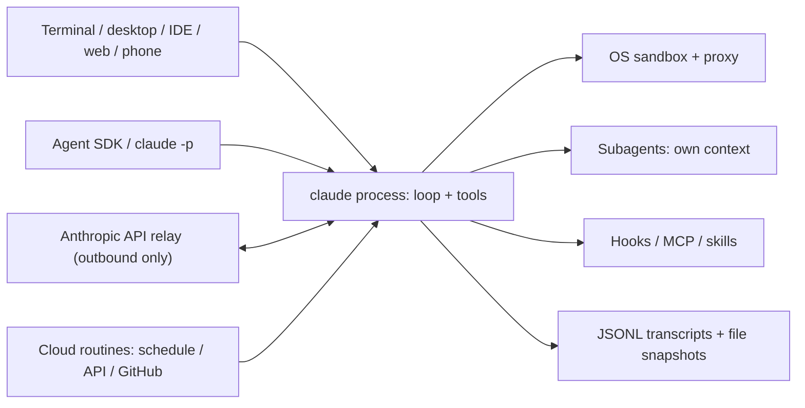
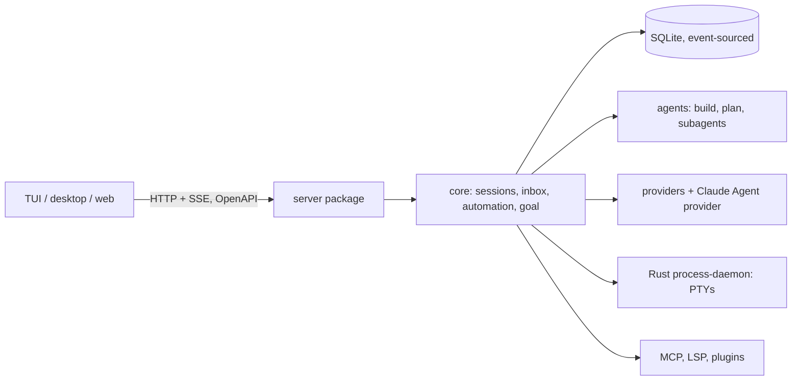
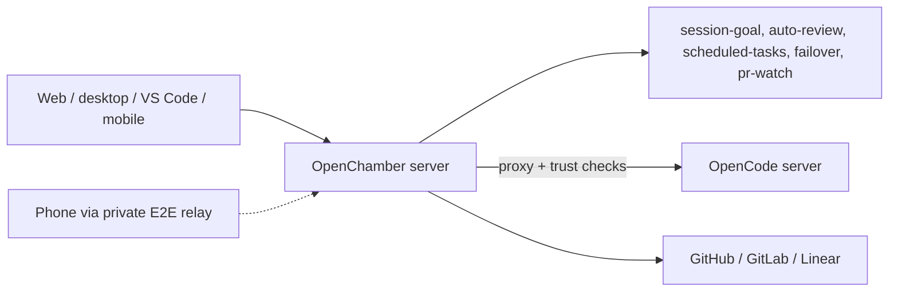
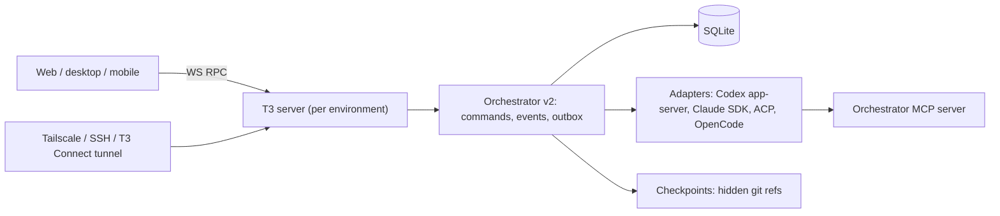
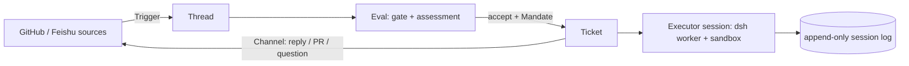
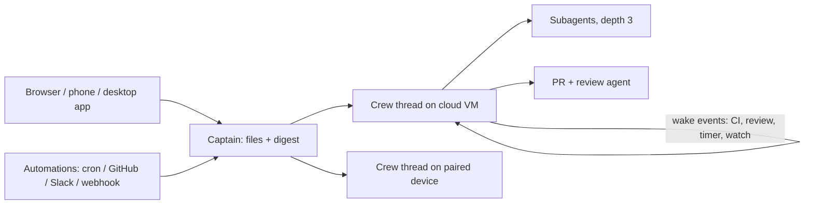

# Agent harness and orchestrator architectures, compared (2026-11-20)

Scope: the architecture of six leading harnesses or orchestrators, three optional ones, and Neko. All web pages and repositories were read on 2026-11-20 unless a line says otherwise. Repository snapshots are shallow clones read that day: OpenCode `d9eb208` (2026-11-20), OpenChamber `cf18602` (2026-11-19), T3 Code `d817e614` (2026-11-20), DeepSeek Harness `2e39e704` (2026-11-18), dsh-superagent-prototype `8c32a9d` (2026-10-31). Nothing was run. "Unknown" means not verified from a source; section 5 lists those. Quotes are limited to one short phrase per source.

Earlier notes this builds on (all in `docs/research/`): `t3code-and-zeron.md` (2026-11-13), `deepseek-harness.md` (2026-11-08), `harness-sweep-2026-11-13.md`, `super-agent-landscape-2026-11.md`. Capy comes from `/tmp/neko-design-refs/capy/capy-inventory.md` (researched 2026-11-20 from `docs.capy.ai`; not committed). Neko cells cite `CLAUDE.md` and `docs/architecture.md`; a separate agent maps Neko in detail.

---

## 1. One section per system

### 1.1 Claude Code (Anthropic, closed binary, SDK libraries public)

- **Process model.** A local CLI process per session (also desktop app, IDE extensions, web, Slack, CI), plus Anthropic-managed cloud VMs, plus Remote Control, where the session keeps running on your machine and a phone or browser attaches through the Anthropic API. The local side makes outbound HTTPS only and never opens an inbound port ([how it works](https://code.claude.com/docs/en/how-claude-code-works), [remote control](https://code.claude.com/docs/en/remote-control)).
- **Loop.** One model, gather context, act, verify, repeat; tools are files, search, shell, web, code intelligence, subagents. A message typed mid-run is queued and read after the current tool calls ([how it works](https://code.claude.com/docs/en/how-claude-code-works)).
- **State.** Plain JSONL transcripts under `~/.claude/projects/`; file snapshots before edits (separate from git); `CLAUDE.md` plus auto memory (first 200 lines or 25 KB load each session); compaction summarizes when context fills and stops after repeated thrash ([same page](https://code.claude.com/docs/en/how-claude-code-works)).
- **Multi-agent.** Subagents have their own context and tool allow-list, nest three layers by default, run up to 20 at once and start in the background; agent teams are separate sessions a lead supervises ([sub-agents](https://code.claude.com/docs/en/sub-agents)).
- **Extensibility and safety.** About 30 hook events (`PreToolUse` can allow, deny, ask, defer or rewrite input; handlers are command, http, MCP tool, prompt or agent) ([hooks](https://code.claude.com/docs/en/hooks)); an OS sandbox (Seatbelt on macOS, bubblewrap on Linux) with a host-side proxy and a domain allow-list, merged with permission rules ([sandboxing](https://code.claude.com/docs/en/sandboxing)).
- **Headless.** `claude -p` with JSON or stream-JSON; the Agent SDK is a library that runs the same binary ([headless](https://code.claude.com/docs/en/headless), [SDK overview](https://code.claude.com/docs/en/agent-sdk/overview)). Cost is reported client-side per run.

### 1.2 OpenCode (`anomalyco/opencode`, formerly `sst/opencode`, MIT)

- **Process model.** A TypeScript monorepo split into `schema`, `core`, `protocol`, `server`, `client`, `tui`, `app`, `desktop`, `plugin`, and a Rust PTY daemon (`packages/process-daemon`). Dependencies run Schema, then Core and Protocol, then Server; clients never import Core ([`AGENTS.md`](https://github.com/anomalyco/opencode/blob/dev/AGENTS.md)). The TUI can attach to an elected background server (`opencode service`, per the same file).
- **Loop and state.** Sessions are event-sourced into SQLite (Drizzle). A prompt first becomes a durable inbox row, then execution is woken; `steer` delivers at the next safe step boundary, `queue` waits for idle ([`specs/v2/session.md`](https://github.com/anomalyco/opencode/blob/dev/specs/v2/session.md)). Execution is process-local, one coordinator per session ID.
- **Agents.** `build` and `plan` are primary; `general` and `explore` are subagents that always run in the background and report to the parent when idle; a subagent started by `general` is refused. Permissions are ordered allow/ask/deny rules, last match wins ([agents docs](https://opencode.ai/docs/agents/)).
- **Always-on.** An `Automation` schema with triggers `at`, `every`, `cron` and `event`, whose action prompts an existing session or a fresh child agent (`packages/schema/src/automation.ts`); a `Goal` state with objective, rounds, `maxRounds` and a stall counter (`packages/schema/src/goal.ts`).
- **Remote and tools.** Generated OpenAPI (173 operations), a volatile SSE event stream, single-use pairing codes with a 5-minute TTL ([server API docs](https://opencode.ai/docs/server/), `packages/server/src/pairing.ts`). LSP is opt-in and about 30 servers ([LSP docs](https://opencode.ai/docs/lsp/)). Providers: many through its model catalog; a v2 spec also runs the user's `claude` through the Agent SDK as a provider (`specs/v2/claude-agent-provider.md`). No OS-level sandbox found in `core` or `server` sources (grep, 2026-11-20).

### 1.3 OpenChamber (`openchamber/openchamber`, MIT, v2.7.3)

- **What it is.** An independent UI and orchestration server layered over OpenCode: shared React UI for web, Electron desktop, VS Code, and a Capacitor mobile shell, with its own Node server that runs or connects to an OpenCode process (`AGENTS.md` "Runtime Boundaries"; `packages/web/server/lib/opencode/DOCUMENTATION.md`).
- **What it adds** (each a module under `packages/web/server/lib/`): `session-goal` (a server-side loop with an independent progress check that keeps going after the UI closes), `auto-review` (review session and reviewed session pass fixes back and forth), `scheduled-tasks` (cron and markdown loops), `limit-failover` (on a usage limit, switch to the provider's next stored account or a fallback model, both opt-in), `pr-watch`, `relay` (outbound-dialled private relay, end-to-end encrypted, untrusted transport), `quota`, `agent-memory` with a "dreaming" tidy pass, multi-run (same task to up to five models, optional worktrees) and a diff walkthrough ([README](https://github.com/openchamber/openchamber/blob/main/README.md)).
- **Lesson.** Almost everything "always on" lives in the server, not the UI, so a closed tab or locked phone changes nothing (`auto-review/DOCUMENTATION.md`).

### 1.4 T3 Code (`pingdotgg/t3code`, MIT)

- **Process model.** One Node server per environment owns provider processes, terminals, git and files; web, Electron and React Native clients speak an authenticated RPC contract (`packages/contracts/src/rpc.ts`) and never substitute their own filesystem or credentials ([`docs/internals/overview.md`](https://github.com/pingdotgg/t3code/blob/main/docs/internals/overview.md)). It installs as a user service (`t3 service install`, `docs/user/background-service.md`).
- **Driving agents.** Adapters per provider: Codex through its app-server protocol (`packages/effect-codex-app-server`), Claude through `@anthropic-ai/claude-agent-sdk` (`apps/server/package.json`), plus ACP agents, OpenCode, Cursor, Pi and others. The orchestrator sees normalized commands and events.
- **State and orchestration.** Orchestration v2: commands are serialized, events are decided without I/O, and one database transaction commits events, projections, the command receipt and outbox effects; an effect worker runs side effects after commit ([`docs/orchestration-v2/`](https://github.com/pingdotgg/t3code/tree/main/docs/orchestration-v2)). Steering modes: steer the active run, queue after it, or interrupt and restart. Checkpoints are hidden git refs. Provider switching uses a budgeted context handoff (`provider-switching-and-context.md`).
- **MCP and always-on.** An app-owned MCP endpoint lets an agent spawn sub-agents on any provider, wait, steer, create threads and schedule recurring work; a child gets only its task prompt (`orchestrator-mcp-server.md`). Server-side thread settlement runs with no client connected. Automation webhooks reach the environment through a relay that stores nothing unless opted in (`docs/internals/t3-connect.md`).
- **Remote.** Direct, Tailscale, SSH or the managed "T3 Connect" tunnel; the relay hands out tunnel hostnames but does not proxy the sessions (`docs/internals/remote.md`, `t3-connect.md`). Mobile push on finish, failure or approval is described in earlier notes (`t3code-and-zeron.md`).

### 1.5 DeepSeek Harness and `dsh-superagent-prototype` (both MIT)

- **Process model.** `dsh` is a Cordis plugin tree assembled from YAML layers: a profile of bundles (`web`, `headless`, `sdk`, `acp`) plus patches; everything including the loop and the session log is a plugin ([`docs/architecture.md`](https://github.com/deepseek-ai/deepseek-harness/blob/master/docs/architecture.md)).
- **Loop.** A step is one model request plus its tools. Read-only tool calls run in a bounded parallel pool, mutating calls one at a time. The rule "model-visible means logged" makes every request reconstructable from an append-only session log, which gives fork, resume and replay ([`docs/agent-lifecycle.md`](https://github.com/deepseek-ai/deepseek-harness/blob/master/docs/agent-lifecycle.md), read 2026-11-08, re-checked on the 2026-11-13 sweep).
- **State and memory.** Session events in JSONL with a generated persistence catalog and type fingerprints; no long-term memory store, only `AGENTS.md`, skills, goals, schedules and session search (`docs/persistence-catalog.md`; `deepseek-harness.md`).
- **Multi-agent and extensibility.** `spawn` and `fork` subagents, a named agent tree with a depth limit, workflow scripts, team mode; sandbox with `read-only`, `workspace-write` and `danger-full-access` (`packages/sandbox/README.md`); RFC 5545 schedules that survive restarts (`packages/schedule/README.md`); MCP and DeepSeek plus pi-ai provider adapters (`packages/llm/README.md`). `SAFETY.md` says the sandbox is not a security guarantee.
- **The superagent prototype.** One GitHub repository, Sources produce Triggers, a stateless Eval decides whether a Trigger asks for work, a Mandate records what was authorized, and a Ticket binds to one Executor session (`docs/001-domain.md`, `003-execution.md`; one SQLite file, `007-architecture.md`). Its stated rule is "as little human attention as possible" (`docs/000-philosophy.md`): act only when asked or when a written rule allows, speak only when a person must act. That is a design principle; no numeric attention budget was found.

### 1.6 Capy (capy.ai, closed; Scrapybara, Inc.)

- **Process model.** Cloud-first: a thread is a durable agent conversation on its own Firecracker microVM or on a paired device (desktop app, or `capy dock` as a headless device); machines sleep about two minutes after work stops (`docs/machines`, `docs/desktop`, `docs/dock` via `capy-inventory.md` section 2.7).
- **Orchestration.** A **Captain** is a long-lived agent that starts and reads a crew of threads in one project. It keeps its plan and rules in its own Drive files (`AGENTS.md`, `CREW.md`, `NOTES.md`, `DIGEST.md`), rewrites a digest of what needs the person, and tags the person only when a decision is theirs. Subagents nest three levels; a crew thread cannot be a Captain (`docs/captains`, `docs/subagents`).
- **Always-on.** Wake events: message, CI result, review, merge or conflict, subagent finished, timer up to 7 days, watch up to 30 days. Automations: cron, GitHub, Slack, webhook, Linear triggers with a plain-English `run_when` gate, opt-in daily run cap, run-as principal (`docs/async-work`, `docs/automations`).
- **Handoff and reach.** "Continue on" cloud or device carries branch, commits and uncommitted changes; follow and reply from any browser including a phone, no native mobile app (`docs/desktop`, `docs/faq`).
- **Models and cost.** About 60 models; connections (subscriptions, keys, gateways) ordered by priority; on a quota run-out the thread waits or uses the next connection; spend by member, model and thread; per-Captain dollar figure (`docs/models-and-pricing`).
- **Closed source:** all architecture above is from docs and changelog; internals unknown.

### 1.7 Optional, kept short

- **Codex (OpenAI, Apache-2.0).** Rust core. The app-server speaks JSON-RPC over stdio, Unix socket or WebSocket with `thread`, `turn` and `item` primitives, `turn/steer` and `turn/interrupt`, server-initiated approval requests, capability-token or signed-bearer auth ([app-server docs](https://learn.chatgpt.com/docs/app-server)). Sandbox modes `read-only`, `workspace-write`, `danger-full-access` on Seatbelt or bubblewrap, with an `auto_review` approver ([sandboxing docs](https://learn.chatgpt.com/docs/sandboxing)). Crate list shows memories, hooks, cloud tasks, a worktree crate and an agent message board (`codex-rs/` listing, 2026-11-20); their behaviour is unread.
- **Paseo (`getpaseo/paseo`, Apache-2.0).** A Node daemon owns agent processes and exposes a WebSocket API and an MCP server; Electron, Expo (iOS, Android, web) and CLI are clients; E2E-encrypted relay for pairing, or direct TCP and Tailscale; schedules start fresh agents on cron and heartbeats re-prompt one existing agent, both on one cron engine ([`docs/architecture.md`](https://github.com/getpaseo/paseo/blob/main/docs/architecture.md), [`public-docs/schedules.md`](https://github.com/getpaseo/paseo/blob/main/public-docs/schedules.md), README). It drives Claude Code, Codex, Copilot, OpenCode, Pi and others.
- **Conductor (conductor.build, closed).** A macOS app; each workspace is its own git worktree with branch, terminal, diff and review flow; runs Claude Code and Codex locally on your existing logins; a "Conductor Cloud" banner exists ([docs](https://www.conductor.build/docs/), [git worktrees page](https://www.conductor.build/docs/concepts/git-worktrees), search snippet only). Internals unknown.

---

## 2. Comparison matrix

Neko cells are short and cite `CLAUDE.md` ("CLAUDE") or `docs/architecture.md` ("ARCH"). "n/s" means not stated in the sources read.

| Question | **Neko** | **Claude Code** | **OpenCode** | **OpenChamber** | **T3 Code** | **DeepSeek Harness / superagent** | **Capy** |
|---|---|---|---|---|---|---|---|
| Process model | Rust daemon (single SQLite writer) on a Unix socket; Swift shell, web UI and Rune are clients (ARCH "Shape", "Two resident processes") | Local CLI per session; cloud VMs; Remote Control to local | Server plus TUI/desktop/web clients; elected background server; Rust PTY daemon | Node server over an OpenCode process; web, Electron, VS Code, mobile clients | One Node server per environment, RPC clients, user service | Cordis plugin tree per profile; superagent is a daemon with one SQLite file | Cloud microVMs or paired devices; web and desktop clients |
| Agent loop | Daemon scheduler claims tickets and runs Codex, Claude or OpenCode in worktrees (CLAUDE "Writable runs", "Existing work") | Claude Code owns the loop and tools; SDK runs the same binary | Own loop in `core`; providers via catalog and AI SDK files | Delegates the loop to OpenCode; adds goal, review loops | Does not own the loop: adapters over Codex app-server, Claude SDK, ACP | Own step loop, parallel read-only tools, log-first | Closed; agent per thread, Captain starts crew threads |
| State and storage | SQLite rows per entity, append-only task events, deferred writes (CLAUDE "Storage layout") | JSONL transcripts, file snapshots, Markdown memory | SQLite, event-sourced, durable inbox | Settings and session metadata store; OpenCode's own state | SQLite, command receipts, outbox, event log about a day | Append-only JSONL session log; SQLite for superagent | Server-side; Drive files outside git, 24h history |
| Multi-agent | Ticket crew, split tickets, crew tools on MCP bridge, per-lease roles; Cats in progress (CLAUDE index "chat directs the crew"; `docs/knowledge/cats.md`) | Subagents depth 3, 20 at once; agent teams | Primary/subagent modes; subagents are background child sessions | Multi-run across up to five models, Fusion | MCP-spawned sub-agents on any provider; child gets only its prompt | spawn/fork subagents, named tree, depth limit; Ticket per Executor | Captain plus crew threads, subagents depth 3, Captains message each other |
| Always-on | Tick every 2 s, watches, routines, catch-up, daily digest, self-update tick (CLAUDE "Idle CPU", "Neko runs the day") | `/loop` (7-day expiry, session-bound); cloud routines, desktop tasks, Channels, `/goal` | `at`/`every`/`cron`/`event` automations; goal state | Server-side goal loop, cron tasks, PR watch | Server-side settlement, scheduled work via MCP, webhooks | RFC 5545 schedules; Source-driven Triggers | Wake events (CI, review, timers 7d, watches 30d); automations with `run_when` |
| Safety | Run authority and approvals, hook deny/cap on test workers, process-tree kill, machine steward holds work (CLAUDE "Machine steward", "Processes an agent leaves behind") | Permission modes plus OS sandbox with proxy allow-list; hooks | Rule-based permissions; no OS sandbox found | Permission auto-accept module, folder trust; sandbox n/s | Approvals per provider; sandbox is the provider's | Three sandbox modes; own docs say not a guarantee | VM isolation; "nothing merges unless asked" rule (inventory section 4) |
| Extensibility | MCP bridge, packs, Luau plugin cards, skills, hooks for outside agents (CLAUDE index) | MCP, hooks, skills, plugins, SDK | Plugins, MCP, LSP, Markdown agents | Third-party panels SDK, extensions, skills catalog | MCP server, provider packages | Everything is a plugin; skills; MCP | Plugins (MCP plus skills), Drive skills, API |
| Providers and quota | Codex, Claude, OpenCode runners; quota read from vendors; switching offered per New Agent row; goals pause on quota hold (docs `switching-provider-when-a-quota-runs-out.md`; CLAUDE index) | Claude models only (plus cloud-provider hosting); `/model` switch | Many; plus Claude Agent provider spec | Inherits OpenCode; auto account switch and fallback model on limit | Many through adapters; budgeted handoff on switch | DeepSeek plus pi-ai; can delegate to Claude Code, Codex, ACP | About 60 models; priority-ordered connections; run-out behaviour |
| UI model | Mac app (Swift shell plus web), Rune native client in progress (ARCH) | Terminal first, desktop, IDE, web | TUI, desktop, web | Desktop, web/PWA, VS Code, mobile | Web, desktop, mobile | Web app, headless, SDK | Web, desktop, no native mobile |
| Remote or phone | Push to Reminders or ntfy; no remote client documented (`phone-push.md`) | Remote Control from phone or browser; cloud sessions | Pairing codes, HTTP API | Private E2E relay, QR pairing, LAN, tunnels, SSH | Tailscale, SSH, T3 Connect, mobile app with push | n/s | Browser from anywhere; device handoff |
| Cost visibility | Usage ledger, history, daily spend ceiling, goal receipts with cost (CLAUDE index) | `total_cost_usd` per run, budget cap flag; estimates | Usage-limit meters in schema | Cost, token and provider-limit panels | Per-turn token usage in provider code; user view n/s | Telemetry package; user view n/s | Per-thread and per-Captain dollars; usage page |
| Self-improvement | Improvements: suggestions applied on click, verified 7 days, undo; skill lessons; curator (CLAUDE index) | Auto memory only (no self-edit loop documented) | n/s | Agent memory with dreaming pass | n/s | Skills and goals; no memory store | Skills in Drive; Memory experiment, status unknown |

### Optional systems on the same rows

| Question | Codex | Paseo | Conductor |
|---|---|---|---|
| Process model | CLI/TUI, app-server (JSON-RPC), cloud tasks | Node daemon plus clients | macOS app, worktree per workspace |
| Agent loop | Own Rust core | Delegates to Claude Code, Codex, Copilot, OpenCode, Pi | Delegates to Claude Code, Codex |
| State | Rollout files and state crate (layout unread) | Daemon registry of projects and workspaces (`data-model.md`) | n/s |
| Multi-agent | Agent graph and message-board crates (unread) | Agents can create worktrees and launch agents; MCP | Parallel workspaces |
| Always-on | n/s | Cron schedules and heartbeats | n/s |
| Safety | Seatbelt or bwrap, approval policies, auto-review | Per-principal permission grants (`docs/permissions.md`) | Inherits the agent's |
| Providers | OpenAI plus local (LM Studio, Ollama crates) | Many agents | Claude Code, Codex |
| Remote | WebSocket with token auth; `codex --remote` | E2E relay pairing, Tailscale | n/s |

---

## 3. Patterns shared by the best-architected systems

Each bullet is true for at least three of the systems studied.

1. **A long-lived server owns execution and state; every UI is a thin client over a typed protocol.** OpenCode, OpenChamber, T3 Code, Paseo, Codex app-server, Capy and Neko all do this (sections 1.2 to 1.7; ARCH "Shape").
2. **Input to a busy agent has named delivery modes: steer now, queue after, interrupt.** Claude Code (queue and Esc), OpenCode (`steer`/`queue` inbox), T3 Code (`steer_active`, `queue_after_active`, interrupt and restart), Codex (`turn/steer`, `turn/interrupt`), Capy (Steer, Interrupt, Queue).
3. **Durable records come before execution.** OpenCode writes an inbox row before waking a run, T3 commits command receipt and outbox with the events, DeepSeek logs everything the model sees, Neko writes rows before acting.
4. **A subagent is a separate session with fresh context and a depth cap.** Claude Code (3 layers), Capy (3 levels), OpenCode (`general` cannot spawn), DeepSeek (injected depth limit), T3 (child gets only its prompt).
5. **A goal outlives a turn and an independent check ends it, with a round cap.** OpenCode `Goal` state, OpenChamber `session-goal`, Claude Code `/goal`, DeepSeek `packages/goal`, Neko goals (CLAUDE index).
6. **Work wakes on events, not only on cron.** OpenCode (`event` trigger), Claude Code (routines on API and GitHub, Channels), Capy (CI, review, merge, timers, watches), T3 (webhooks, settlement), Paseo (heartbeats), Neko watches.
7. **The OS boundary is separate from the permission prompt.** Claude Code and Codex both use Seatbelt or bubblewrap beneath approval rules; DeepSeek has a sandbox package with three modes (sandbox docs, section 1).
8. **Remote reach is outbound-dialled or tunnelled, with short-lived pairing and no inbound port.** Claude Code Remote Control, OpenChamber's relay, Paseo's relay, T3 Connect, OpenCode pairing codes.

---

## 4. Where Neko is ahead, and where it is behind

### Ahead (5)

1. **Machine stewardship.** A steward reads load, memory, swap and disk every 15 s and holds or caps new agents; the daemon records and SIGKILLs descendants an agent leaves behind; a PreToolUse hook gives outside agents the same rules and caps test workers (CLAUDE "Machine steward", "Processes an agent leaves behind"). No other system studied documents a comparable load-aware admission gate; Claude Code kills the process tree on SIGTERM only ([headless](https://code.claude.com/docs/en/headless)). *Keep the lead:* export the steward as a standalone `machine-ok` signal for other harnesses to consume (already begun with `--machine-check`).
2. **Evidence-gated goals with receipts and undoable defaults.** Judge needs evidence, a redacted receipt artifact with cost, and a deadline default that can be undone (`docs/knowledge/goal-receipts.md`, `deadline-default.md`, `goals-that-keep-working.md`). OpenCode's and OpenChamber's goal loops record reason and rounds but no receipt or undo (`schema/src/goal.ts`, `session-goal/DOCUMENTATION.md`). *Keep the lead:* put receipts and undo targets in the protocol so Rune and web render the same objects.
3. **Prior-work and duplicate gates before a run.** `duplicates::duplicate_of` and `prior_work::find` look at issue keys, branches and open PRs before the first checkout (CLAUDE "Duplicates", "Existing work"). No other studied system documents this. *Keep the lead:* run the same check on cat-created tasks, since Capy's Captains can fan out duplicate work.
4. **Measured write and idle budgets.** Rows per entity, deferred writes, a content stamp so idle loads cost about a millisecond, each change tied to a measured number (CLAUDE "Resource limits", "Idle CPU"). T3's outbox transaction is stronger on correctness, but none of the others publish write-budget measurements. *Keep the lead:* a CI test that fails when idle bytes written per minute exceed a ceiling.
5. **Self-improvement that is verified and reversible.** Repeated trouble becomes one suggestion applied on a click, checked for 7 days, with Undo (`docs/knowledge/self-improvement.md`). OpenChamber has a memory tidy pass and Claude Code has auto memory, but neither verifies an applied change. *Keep the lead:* record the verification result on the suggestion so a failed one blocks the same suggestion returning.

### Behind (5)

1. **Remote reach.** Neko pushes needs-you items to a phone but has no remote client; its web UI is served by the local daemon only (CLAUDE "installed app updates itself", `phone-push.md`). Claude Code, OpenChamber, Paseo, T3 and Capy let you follow and answer from a phone. *Change:* an authenticated daemon endpoint plus an outbound-dialled E2E relay with single-use short-TTL pairing codes (OpenCode's `pairing.ts` and OpenChamber's `relay/` are the patterns), starting with read, answer and approve only.
2. **No second place to run.** Everything runs on one Mac that the steward may hold or cap, and a sleeping laptop stops work. Capy has cloud VMs and device handoff; Claude Code has cloud sessions; T3 and Paseo reach several environments. *Change:* make the daemon a runnable execution host on a second machine (the `capy dock` and T3 "environment" shape), with an `execution_host` field on a ticket and `Task::base_commit` plus the hidden-ref checkpoints as the handoff unit.
3. **Sandbox is the agent's, not Neko's.** Neko composes the run authority, approvals and hooks, but its own doc says filesystem read privacy is not provided by the Codex sandbox (`docs/knowledge/chat-tool-authority.md`). Claude Code ships a sandbox runtime with a proxy allow-list; Codex and DeepSeek own one. *Change:* launch every runner under a Seatbelt profile from `native_runner::spawn_guarded` (write only the worktree, network through an allow-list proxy), as the open `sandbox-runtime` package does.
4. **Provider failover is manual.** Neko reads quotas and offers a switch per New Agent row; goals pause on a quota hold; no automatic move to another provider or account is documented (`switching-provider-when-a-quota-runs-out.md`, CLAUDE index). OpenChamber's `limit-failover` switches account or fallback model, and Capy orders connections by priority. *Change:* a ticket-level provider chain with a typed quota error that parks until reset or takes the next connection, with T3's budgeted context handoff instead of a model summary.
5. **Clients hand-mirror the protocol.** Rune keeps an allow-list mirror of the web's requests (`docs/knowledge/rune-parity-a.md`); OpenCode generates clients from OpenAPI and Codex generates TypeScript and JSON schema from the server (`codex app-server generate-ts`). *Change:* generate the web and Rune request types from `neko-protocol` so a new command cannot exist in one client only.

---

## 5. Unverified

- Claude Code internals are closed: compaction algorithm, auto-mode classifier, how MCP tool search defers definitions. Only documented behaviour is cited. Whether the Agent SDK's session store differs from the CLI's is not checked.
- OpenCode: the "elected background server" comes from `AGENTS.md` only; no code read. Event stream replay is volatile per the API doc; durable replay for clients is not verified. Whether the Claude Agent provider spec is implemented is unknown. Sandbox absence is a grep result, not a statement from the project.
- OpenChamber: relay encryption and failover claims come from its own module docs and README, not an audit. Sandbox behaviour unknown. "Jev" (named in `session-goal`) was not looked up.
- T3 Code: SQLite as the server store is inferred from the orchestration docs and earlier notes; the persistence directory was not read. Pairing mechanics for `t3 up` not read. Mobile push comes from the earlier note, not re-read.
- DeepSeek: the superagent README says some designs in its article are future work, so the prototype may not implement every attention-saving idea. No attention-budget counter was found, only the philosophy document. The model-delegation providers (Claude Code, Codex, ACP) come from the 2026-11-08 note.
- Capy: everything is from docs, changelog and screenshots; internals, Memory feature status, mobile app status and customer numbers are unverified (see `capy-inventory.md` section 7).
- Conductor: docs were thin; worktree model comes from search snippets of its own pages; checkpoints, MCP and Cloud behaviour unknown. Codex: only the app-server and sandboxing pages and a crate listing were read; memory, agent graph and cloud-task behaviour unread. Paseo: sandbox and cost behaviour not read.
- Neko cells rest on `CLAUDE.md` and the cited knowledge docs, not on code reads. Cats are mid-build (records, files and requests landed; see `docs/knowledge/cats.md`). The claim that Neko has no remote client and no automatic provider failover is "not documented in the docs read", not a code audit.

## Orchestrator note (2026-11-20)
The "sandbox belongs to the agent" gap is partly wrong: the code already launches some runs under a macOS Seatbelt profile through `neko-daemon --neko-native-runner-guard /usr/bin/sandbox-exec -p …` (observed on a running install). What is missing is one consistent Neko-owned profile for every runner, not sandboxing itself. Neko cells in the matrix come from the docs, not a code audit; see `docs/architecture/system-map-2026-11.md` for what the code does.
